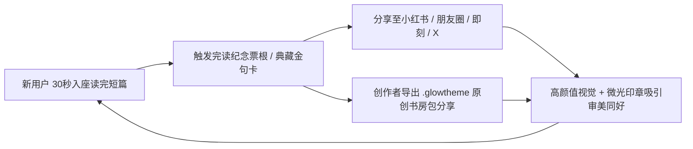
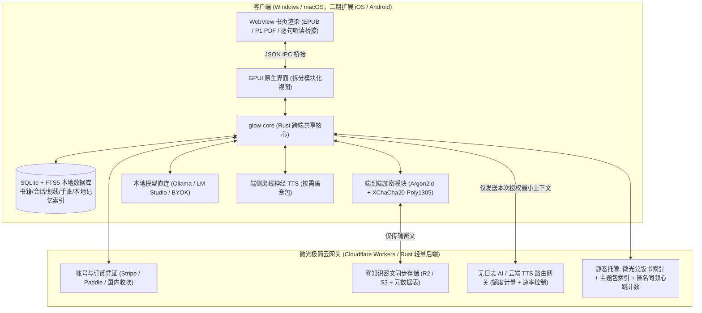
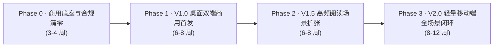

# 微光阅读（Glow Reading）2.0 商用演进产品战略与架构蓝图

> **文档状态**：已评审定稿（2026-11-27）  
> **定位宣言**：为高压时代的现代读者打造一座**“打开那一刻，世界就安静下来”**的治愈系沉浸阅读书房——以零焦虑的阅读心流为核心，用原创五感美学、防剧透专属共读与私密情绪手账，把“读一本书”变成一场温柔的日常自我疗愈。

---

## 1. 第一性原理诊断：从“惊艳的极客作品”到“可商用的治愈系精品”

### 1.1 现状资产盘点（基于仓库真实代码）

微光阅读当前的工程积累远超普通早期原型，全仓 Rust 代码已达 **31,863 行**，具备极佳的差异化地基：

| 现有核心资产 | 代码锚点 | 商业潜力评估 |
| :--- | :--- | :--- |
| **原生高颜值桌面框架** | [`app.rs`](../crates/desktop/src/app.rs)、[`prism.rs`](../crates/desktop/src/prism.rs) | GPUI 原生渲染 + WebView 书页桥接，流畅度与美学表现明显优于传统 Electron 套壳阅读器 |
| **防剧透 AI 伴读与人物图谱** | [`BookCompanionCache`](../crates/core/src/model.rs#L80-L92)、[`book_context.rs`](../crates/core/src/book_context.rs) | **全市场最稀缺的硬核护城河**：严格按已读进度截断未来章节，精准戳中长篇小说读者的遗忘痛点 |
| **6 轨程序化自然声景混音台** | [`SoundscapeMix`](../crates/core/src/model.rs#L201-L209)、[`soundscape.rs`](../crates/desktop/src/soundscape.rs) | 纯本地实时音频合成，零版权风险、体积小、听感柔和，天然契合治愈品牌 |
| **情绪手账与金句卡片引擎** | [`quotecard.rs`](../crates/desktop/src/quotecard.rs)、[`mood.rs`](../crates/desktop/src/mood.rs) | 天然具备小红书/朋友圈/即刻的高审美自然裂变基因 |
| **多端同步数据合并算法** | [`SyncSnapshot`](../crates/core/src/sync.rs#L12-L27) | 已具备带墓碑删除（tombstone）的双向合并模型，为云端无感同步铺平了核心算法 |

### 1.2 从第一性原理拆解：“阅读兴趣、幸福感与心灵疗愈”的本质

为什么绝大多数人“买书如山倒、读书如抽丝”，且传统阅读器留存低、付费弱？回归第一性原理，读者在意的从来不是“工具参数有多全”，而是以下四个本质环节：

1. **启动摩擦决定了阅读兴趣**：下班后大脑电量只剩 10%，打开软件如果面临“空书架、自己找 EPUB、繁琐配置”，大脑会立刻退回短视频；只有**“30 秒内进入温暖氛围 + 刚好适合今晚心情的一篇好字”**，才能重新唤醒阅读欲。
2. **心流保护决定了沉浸深度**：传统软件充满弹窗、生硬工具栏和知识焦虑（打卡、排行榜、未读红点）。真正的治愈阅读是**感官降噪（柔和光影、纸感排版、自然声景）+ 零打断辅助（纸边查词、防剧透唤醒）**。
3. **被接住的情绪决定了心灵疗愈**：阅读之所以治愈，是因为文字替说不出口的委屈与迷茫找到了回声。当软件不仅懂此刻的书，还**记得你过去读过的书与划过的句子**，在某个雨夜把“过去的自己”和“此刻的文字”温柔连线，治愈感才真正发生。
4. **有始有终的仪式感决定了幸福感**：多数阅读器翻到最后一页就戛然而止。幸福感来自**“微小累积被温柔看见”**以及**“合上书那一刻的纪念余韵”**，而非断签惩罚。

### 1.3 制约商业化的五大现实卡点

> [!WARNING]
> 以下 5 个卡点不解决，即使再多堆 20 个新功能，微光也难以跨过“免费极客玩具 → 规模化付费精品”的鸿沟。

1. **主心智分散**：[`app.rs`](../crates/desktop/src/app.rs#L67-L74) 中 `Shelf / Reader / Mood / Radio / Journal / Themes` 六大入口平权，新用户不知它究竟是阅读器、电台还是日记本。
2. **冷启动空书架死穴**：仅支持本地无 DRM EPUB/TXT 且只内置 1 篇短篇，把 80% 想要放松但手里没有现成书源的大众用户挡在门外。
3. **极客配置门槛**：AI 与同步需自备 API Key 或 GitHub Token（[`LocalSecrets`](../crates/core/src/model.rs#L417-L420)），文艺/治愈受众无法开箱即用。
4. **三大商用合规红线**：
   - 主题直接借用宫崎骏作品名（[`themes()`](../crates/core/src/model.rs#L580-L664) 中的龙猫、千寻、哈尔、魔女、汤屋）；
   - 听书依赖非官方逆向库 `kothok-edge-tts`（[`Cargo.toml`](../crates/desktop/Cargo.toml#L25)、[`tts.rs`](../crates/desktop/src/tts.rs#L3)），商用随时断流；
   - 电台硬编码第三方公益流媒体直链（[`radio.rs`](../crates/desktop/src/radio.rs#L110-L150) 中的 SomaFM / Radio Swiss Classic），存在未授权商业嵌入风险。
5. **工程与发行底座缺口**：单文件 [`app.rs`](../crates/desktop/src/app.rs) 已达 11,008 行；数据存于未加密单一 `state.json`（[`store.rs`](../crates/core/src/store.rs#L18-L24)）；仅打包未签名 Windows ZIP（[`package-windows.ps1`](../scripts/package-windows.ps1)），无代码签名、无自动更新、macOS 未验收且无移动端延伸。

---

## 2. 战略共识总览（17 项已锁定核心决策）

| 战略维度 | 锁定决策 |
| :--- | :--- |
| **核心主心智** | 唯一主轴为**治愈系沉浸阅读书房**；顶层收敛为**「书房 / 书页 / 手账」三主轴 + 底部常驻氛围/电台胶囊** |
| **内容源头与格式** | 不碰重版权采买；**P0** 内置高审美合法**微光公版馆 + 心情选书 + OPDS + 纸边查词 + 书架状态管理**；**P1** 扩展 **PDF 优雅阅读 + 网页剪藏/RSS 慢读箱 + Obsidian/Notion 导出** |
| **情感反馈与社交** | 打造**反焦虑三件套**（无压力微光累积、完读纪念票根 + AI 私信、跨时空重逢），坚决不做断签惩罚与排行榜；**零 UGC 审核**，仅做可选的匿名同频灯火微光 + 站外高颜值卡片裂变 |
| **AI 陪伴边界** | 不做泛用聊天框；严格聚焦 4 大高壁垒场景：**久别重逢防剧透唤醒、跨书个人记忆共鸣、防剧透纸边解惑、完读私信与心情荐书** |
| **五感杀手锏** | **原创「微光空间」主题宇宙**（画面+纸纹+声景+卡片四位一体）、**昼夜自然光影随动**、**听读逐句高亮跟随 + 睡前渐弱熄灯** |
| **商业化模式** | **永久免费零广告底座 + 微光会员 Glow+ 订阅（云端 AI/加密同步/情感听书/全美学资产）+ 早鸟本地典藏版一次性买断（不含持续云成本）+ 保留 BYOK/本地模型** |
| **平台与市场** | 精益团队节奏，中文优先且架构双语就绪；**桌面双端（Win + macOS）先立标杆并签名发布**，二期复用 `glow-core` 补齐**轻量移动端伴侣** |
| **隐私与合规** | 商用前彻底清理 IP/TTS/Radio 风险；采用 **Local-First + SQLite/FTS5 + 私密锁 + E2EE 零知识云同步 + 本地检索最小上下文上云**；听书采用**本地离线神经 TTS + 正规商用云 TTS 双轨** |
| **商用发行门禁** | V1.0 硬性门禁：Win/macOS 代码签名与自动更新、30 秒冷启动治愈引导、拆分 `app.rs` 模块化架构、用户授权的隐私友好崩溃诊断 |

---

## 3. 信息架构重塑：让每一次打开都成为治愈仪式

### 3.1 从“6 页并列工具箱”到“阅读前-中-后情感闭环”

```mermaid
flowchart LR
    subgraph Before["阅读前 · 书房 (Study)"]
        A1["早晚光影问候 + 续读主卡"]
        A2["心情选书 & 今晚短篇推荐"]
        A3["我的书架 (想读/在读/完读/书单)"]
        A4["微光公版馆 & OPDS 书源"]
    end

    subgraph During["阅读中 · 书页 (Pages)"]
        B1["纯净纸感排版 + 昼夜光影"]
        B2["久别重逢 · 30秒防剧透浮卡"]
        B3["纸边注脚 (查词/古文/防剧透解惑)"]
        B4["书桌伴侣抽屉 (AI图谱 / 听读同步 / 6轨声景)"]
    end

    subgraph After["阅读后 · 手账 (Journal)"]
        C1["合并原心情与日记: 心灵时间轴"]
        C2["划线沉淀 + 跨时空重逢回响"]
        C3["合上书仪式: 完读纪念票根 + AI私信"]
        C4["金句卡导出 / Markdown 归档"]
    end

    subgraph Dock["常驻氛围层 (Ambient Dock)"]
        D1["底部微光胶囊: 声景混音 / 深夜电台 / 熄灯定时"]
        D2["顶部书房换装: 原创主题宇宙 / 昼夜随动"]
        D3["可选同频微光: 此刻 N 盏静读灯火"]
    end

    Before -->|"一键点亮台灯开读"| During
    During -->|"划线 / 心情回响 / 完读"| After
    After -->|"跨时空重逢 / 心情荐书"| Before
    Dock -.->|"全程不断流伴随"| Before
    Dock -.->|"全程不断流伴随"| During
    Dock -.->|"全程不断流伴随"| After
```

### 3.2 新旧页面收敛对照

| 旧架构（6 顶级页） | 新架构归属 | 重构意图 |
| :--- | :--- | :--- |
| `Shelf`（书架） | **主轴 1：书房** | 升级为“打开就有归属感”的首页，融合续读、今日重逢、心情选书、书架分类与微光公版馆 |
| `Reader`（阅读） | **主轴 2：书页** | 绝对主角；所有辅助能力（声景、听书、防剧透图谱、搜索、排版）收进右侧可折叠“书桌伴侣抽屉”，默认隐藏 |
| `Mood` + `Journal` | **主轴 3：手账** | 消除“心情页和日记页割裂”的迷惑；顶部保留极轻的“写下此刻心境”输入条，下方统一呈现“心情随笔 + 书摘回响 + 完读票根”时间轴 |
| `Radio`（深夜电台） | **底部常驻氛围胶囊（展开全屏电台模式）** | 变成“看书累了，合上书听一会儿”的无缝切换，不再和阅读器争抢第一导航位 |
| `Themes`（主题） | **书房换装抽屉 / 独立设置视图** | 降低高频导航噪音，同时把“换装”与昼夜光影、专属声景配方、金句卡风格绑定为统一体验 |

### 3.3 “30 秒爱上微光”冷启动治愈仪式

取代当前首次启动只弹隐私说明（`privacy_seen`）的冰冷入口，重塑 3 步零压力入座流程：

1. **选一间今晚的书房**（10 秒）：横排展示 3 套核心原创微光空间（「晴空旧书房」「素纸晨光」「雨夜灯笼巷」），鼠标悬停即时切换光影与 15% 轻柔环境音试听。
2. **挑一篇今晚读得完的字**（10 秒）：给出 3 个温柔情绪入口——*“有点疲惫，想被接住”* / *“想在睡前读个短故事”* / *“我带了自己的书”*，对应预置公版精选短篇（标注约 5–8 分钟读完）或直接拖拽导入。
3. **点亮台灯，铺开书页**（10 秒）：平滑过渡进入正文，书页边缘轻提示“选中任意一句，可留下微光划线或听见回响”，同时用极简一行说明隐私承诺（“本地优先，你的字只属于你”）。

---

## 4. 核心功能演进与产品取舍矩阵

### 4.1 提升阅读兴趣与幸福感：反焦虑治愈三件套

1. **无压力微光累积（升级 [`reading_minutes_today`](../crates/core/src/model.rs#L720-L722)）**
   - 新增完整的 `reading_sessions` 记录表（书籍、起止时间、页数/进度增量、当时主题与心情标签）。
   - 视觉呈现为**“柔和阅读月历 + 书房微光温度”**：每静读 15 分钟便点亮一颗温暖光点或让窗景细节更丰富；**哪怕隔两周没打开，既有微光永远保留、永不清零**，从根源消灭打卡焦虑。
2. **合上书的仪式：完读纪念票根 + AI 完读私信**
   - 当进度达到 98%+ 或用户点击“标记完读”，触发柔和的合书动效，自动生成一张**“微光完读纪念票根”**（包含书名、起止阅读日期、陪伴总时长、最动人的一句划线、书房印章），支持一键保存高清 PNG 分享。
   - 若开启 AI 伴读，系统结合你在本书留下的划线与手账感悟，寄出一封 300 字左右的**“合上这本书的来信”**，像一位懂你的老友陪你回味余韵。
3. **跨时空重逢（升级 `NextRediscovery`）**
   - 基于间隔重复与季节/夜晚触发规则：把 30 天前、90 天前或去年同日划过的心动句子，搭配当时写下的笔记，在首页以“一封来自过去自己的明信片”温柔递出。

### 4.2 克制的专属 AI 共读者（4 大高壁垒场景）

| AI 场景 | 触发方式 | 技术实现关键点 | 为什么外部通用 AI 替代不了 |
| :--- | :--- | :--- | :--- |
| **1. 久别重逢 · 防剧透唤醒** | 隔 ≥3 天再开长篇书时顶部浮现轻提示卡片 | 复用 [`SpoilerSafeContext`](../crates/core/src/book_context.rs#L19-L29) 严格截断未读章节，30 秒回顾上回剧情与核心人物状态 | 彻底解决“隔一周忘了人物是谁、上网搜却被剧透一脸”的头号弃书痛点 |
| **2. 跨书个人记忆共鸣** | 选中书页句子点击“微光回响” | 先在**本地 SQLite/FTS5 + 轻量标签/语义索引**中匹配用户历史划线与手账中 2–3 条最相关记录，仅将精选片段送入模型生成私人化共振 | 越用越懂你——*“你去年冬夜读《瓦尔登湖》时，也写过相似的句子”*，形成极强的情感迁移壁垒 |
| **3. 防剧透纸边解惑** | 选中难句、古文、外国历史典故点击“纸边注脚” | 带入当前段落上下 2 段 + 已读进度边界，输出 80 字以内克制注释，直接悬浮在页边 | 不跳出阅读器、不剧透后续反转、不破坏纸书沉浸感 |
| **4. 完读私信 & 心情荐书** | 书籍完读时 / 首页选择当下心情时 | 结合本书划线生成完读信；心情低落时从用户书架未读书目 + 微光公版馆中精准挑出 1 篇今晚能读完的篇章 | 精准承接“想读点什么但不知道读什么”的情绪启动瞬间 |

### 4.3 五感治愈杀手锏

1. **原创「微光空间」主题宇宙（四位一体资产标准）**
   - 每套官方主题统一封装为可校验扩展包，包含：**原创无版权风险手绘场景 + 纸张微肌理/护眼色板 + 专属 6 轨声景默认配方 + 配套金句卡与完读票根版式**。
   - 开放 `.glowtheme` 创作者规范，未来允许独立插画师/用户分享原创书房空间（自带社区传播而不涉文字 UGC 审核）。
2. **昼夜自然光影随动（可选开关）**
   - 依本地日出日落时间，在**晨光（清透暖白）→ 午后（柔和纸白）→ 黄昏（琥珀落日）→ 深夜（低蓝光暗夜暖灯）**之间平滑插值过渡色温与对比度，让桌面书房像真实靠窗书桌一样呼吸。
3. **真正的“听读同步”与睡前渐弱熄灯**
   - 在 [`book_context.rs`](../crates/core/src/book_context.rs#L31-L36) 的 [`TtsSegment`](../crates/core/src/book_context.rs#L32-L36) 中补充精确的 `cfi` / DOM 段落定位锚点，通过 [`reader.ts`](../web/src/reader.ts) 桥接实现**朗读到哪一句、正文就亮起哪一句柔和微光并自动平滑翻页**。
   - 睡前定时器（15 / 30 / 45 分钟或“本章读完后”）结束前最后 60 秒，**朗读音量、背景声景与书页暖光同步线性淡出**，无突兀切断惊醒睡意。
4. **零社交压力的“同频微光”**
   - 首页角落与专注阅读底栏可选显示一颗微弱呼吸灯与一行小字（例如*“此刻，世界上有 428 盏微光正与你一起静读”*）。后台仅需一个极轻的匿名心跳计数接口，**无账号资料、无评论、无私信、零内容审核成本**。

### 4.4 内容源头与阅读器硬实力（分期清单）

| 优先级 | 核心功能 | 关键体验标准 |
| :--- | :--- | :--- |
| **P0（V1.0 首发）** | **微光公版馆 + 心情选书** | 精选 50–100 部高质量精排中英文公版好书（散文/诗集/短篇/童话/哲学，严格核验公版边界），按“10 分钟短篇 / 睡前治愈 / 深度长篇”分类，一键下载直读 |
| **P0（V1.0 首发）** | **OPDS 标准书源接入** | 支持用户添加主流合法公共图书馆 / Calibre / 个人 NAS 的 OPDS 目录，承接存量重度电子书玩家 |
| **P0（V1.0 首发）** | **纸边查词与离线词典** | 选中词句即时弹出柔和纸边释义（内置轻量开源英汉/汉语词典 + 支持接入 StarDict/MDX 或语境 AI 解释） |
| **P0（V1.0 首发）** | **完整书架管理** | 状态流转（想读 / 在读 / 已读完 / 搁置）、自定义书单/标签、封面替换、元数据编辑、批量拖拽导入 |
| **P1（V1.5 扩张）** | **PDF 优雅阅读** | 引入 PDFium / pdf.js 渲染，提供**护眼纸感滤镜、自动裁切白边、暗夜智能反色、高亮与批注**，把冷冰冰的 PDF 资料也变成温暖书页 |
| **P1（V1.5 扩张）** | **网页长文剪藏 & RSS 慢读箱** | 浏览器一键剪藏或粘贴 URL 自动提纯正文为 EPUB/清爽慢读页；订阅精选博客/Newsletter，每周五晚自动整理成一期“周末慢读小报” |
| **P1（V1.5 扩张）** | **外部知识库联动** | 一键将单本书或全部划线/笔记/手账按模板导出或双向同步至 **Obsidian / Notion / Markdown** |

### 4.5 明确边界：“坚决不做”清单

> [!IMPORTANT]
> 精品软件的灵魂在于克制。以下功能与微光的核心定位直接冲突，明确**永久排除**：
> - ❌ **不做**连续打卡天数、断签扣分、全站阅读时长排行榜（破坏治愈感，制造阅读内卷）。
> - ❌ **不做**书评广场、弹幕想法、私信关注等重 UGC 社交社区（毁掉宁静独处感，且引入高昂审核合规成本）。
> - ❌ **不做**通用多轮 AI 聊天室或浮夸角色扮演（沦为廉价套壳，稀释书房心智）。
> - ❌ **不做**广告弹窗、开屏推广、强制登录后才允许本地看书（摧毁信任感）。

---

## 5. 商业化模式、定价阶梯与单位经济测算

### 5.1 三层权益与定价体系

| 权益维度 | 免费版（永久免费 · 零广告 · 无需登录） | 早鸟本地典藏版（限时买断：¥98 / $19） | 微光会员 Glow+（¥18/月 · ¥148/年；海外 $3.99/月 · $29.99/年） |
| :--- | :--- | :--- | :--- |
| **基础阅读与书架** | 完整 EPUB/TXT、书架管理、内置公版馆精选、OPDS、离线查词 | 全部包含 + **P1 阶段 PDF 优雅阅读 & 慢读箱本地版** | 全部包含（含 PDF 与慢读箱全能力） |
| **原创主题与光影** | 3 套经典原创书房 + 基础自定义 | **永久解锁全部官方原创主题宇宙 + 昼夜自然光影** | 全套原创主题宇宙 + 季更限定主题 + 昼夜光影 |
| **声景与听书** | 基础 2 轨环境音 + 离线神经 TTS 听书（含听读高亮与渐弱熄灯） | **永久解锁 6 轨完整混音 + 原创免版税治愈曲库** | 6 轨完整混音 + **每月含 15 小时商用高情感云端听书（支持音频缓存）** |
| **AI 共读陪伴** | 预写本地回响 + **无限使用 BYOK（自带 API Key / 本地 Ollama）** | 同左（完整保留 BYOK 与本地模型支持） | **开箱即用免配置云端 AI 伴读**（每月充裕积分：约 150 次回响/解惑 + 20 次长篇防剧透图谱 + 完读私信；超额可购加油包） |
| **隐私手账与卡片** | 无限本地手账、私密锁、基础金句卡与完读票根 | **典藏无水印金句卡/完读票根全模板 + Obsidian/Markdown 导出** | 全部典藏模板 + 外部知识库联动 |
| **跨端同步** | 本地文件夹 / 私有 GitHub 同步 | 本地文件夹 / WebDAV / 私有 GitHub 同步 | **开箱即用零知识 E2EE 云同步**（进度/划线/手账/自定义主题 + 2GB 加密书籍同步空间） |

> [!TIP]
> **早鸟买断的战略意义**：独立/精益团队冷启动期最怕前期零现金流与冷清口碑。推出“早鸟本地典藏版”能快速转化第一批认可审美的种子用户并引发自发安利；同时**严格划清“本地能力永久买断、云端算力按会员/加油包付费”的红线**，彻底避免陷入“终身买断却倒贴 AI 账单”的商业陷阱。

### 5.2 “不破坏治愈感”的温柔付费触点

- **永不在阅读正文过程中弹付费窗**，永不在侧栏放闪烁促销角标。
- **体验先行**：所有原创主题均可全屏预览 60 秒；新用户赠送“7 天微光全境体验券”（含 20 次云端防剧透/回响体验与 2 小时云端情感听书），让用户先切身感受“隔周回来看书被防剧透卡片救了”或“读完一本书收到 AI 来信破防了”的魔法瞬间，再自然产生升级意愿。
- **柔和引导文案**：额度用尽时仅显示轻纸笺提示——*“本月的云端微光额度已陪你走完一段旅程。你可以升级 Glow+ 续点微光，或随时切换至自带密钥 / 本地离线模式继续免费阅读。”*

### 5.3 单位经济测算（Unit Economics）

以国内年付会员（¥148/年 ≈ **¥12.3/月**）与海外年付会员（$29.99/年 ≈ **$2.50/月 ≈ ¥18.0/月**）测算单活跃会员月度可变成本：

| 成本项 | 典型活跃用户月消耗预估 | 成本控制策略 | 月均单户成本（RMB） |
| :--- | :--- | :--- | :--- |
| **云端 AI 伴读** | ~60 次短回响/解惑 + ~4 次长篇图谱 + ~2 封完读信（约 15 万 Input + 3 万 Output Token） | 路由轻量高性价比模型（如 DeepSeek / Qwen-Plus / GPT-4.1-mini）+ 章节摘要本地缓存不重复解析 | **¥0.60 – ¥1.50** |
| **云端情感 TTS** | ~5–8 小时（约 8 万–12 万字） | 章节音频按哈希本地持久化缓存，重复听零成本；结合高性价比商用神经语音 | **¥0.80 – ¥1.80** |
| **E2EE 云同步存储与流量** | 文本元数据 < 5MB + 书籍密文平均 ~80MB | 文本增量同步 + 对象存储（R2/OSS 低流量费）+ 仅同步用户勾选书籍 | **¥0.20 – ¥0.50** |
| **支付通道与税务手续费** | Paddle / Stripe / 商店抽成（约 5%–15%） | 官网直付优先，应用商店做引流补充 | **¥0.80 – ¥2.20** |
| **合计月均单户成本** | — | — | **¥2.40 – ¥6.00 / 月** |
| **预估毛利率** | 国内 ¥12.3/月 → 毛利 **51%–80%**；海外 ¥18.0/月 → 毛利 **67%–86%** | 极重度用户由月度额度软上限 + 加油包兜底，杜绝亏损 | **目标综合毛利 > 70%** |

### 5.4 低成本自然增长飞轮

---

## 6. 合规重构、隐私架构与技术底座演进

### 6.1 商业化前三大合规红线清零清单

#### 1. 主题资产彻底原创化（替换 [`themes()`](../crates/core/src/model.rs#L580-L664)）

| 原主题名（IP 风险） | 重构后原创「微光空间」命名 | 配套视觉与默认声景配方 |
| :--- | :--- | :--- |
| 林间暖光（天空之城） | **晴空旧书房 · Sky Study** | 蓝天云影水彩 + 暖纸 + `细雨 + 微风` |
| 龙猫林荫 | **夏风樟树下 · Camphor Shade** | 绿荫日光斑驳 + 青草纸感 + `微风 + 细雨` |
| 千寻海轨 | **浅海晚风号 · Twilight Sea** | 暮色浅海与远岸灯塔 + 浅绯纸 + `海轨 + 琴韵` |
| 哈尔花原 | **山谷秘密花园 · Meadow Breeze** | 薰衣草与晨雾花海 + 柔紫纸 + `微风 + 琴韵` |
| 魔女海镇 | **海港烘焙屋 · Harbor Bakery** | 暖橘海风小镇窗台 + 奶油纸 + `壁炉 + 微风` |
| 汤屋灯夜 | **雨夜灯笼巷 · Lantern Rain** | 深夜暖灯雨窗 + 琥珀暗纸 + `细雨 + 壁炉` |
| 素纸 / 静夜 / 黑曜棱镜 | **素纸晨光 / 静夜台灯 / 星空棱镜**（保留并升级） | 原创极简护眼与光影交互系列 |

#### 2. 听书双轨合规替换（替换 [`tts.rs`](../crates/desktop/src/tts.rs#L3) 中的 `kothok-edge-tts`）

- **抽象统一 `TtsProvider` Trait**：
  - **离线免费轨（`LocalNeuralTts`）**：应用内提供“按需下载轻量离线语音包”（基于 Apache-2.0/MIT 商用友好的 Sherpa-ONNX / Kokoro 等端侧推理模型），下载一次永久离线流畅朗读；未下载语音包时优雅降级至系统原生 TTS（Windows OneCore / macOS AVSpeechSynthesizer）。
  - **云端会员轨（`CloudHealingTts`）**：通过微光轻量网关转发至正规商用情感语音 API（支持温柔女声、沉稳说书男声、英日多语种），响应音频按 `(book_id, chapter_hash, segment_idx, voice_id)` 缓存至本地磁盘，避免重复计费。

#### 3. 电台合规重构（替换 [`radio.rs`](../crates/desktop/src/radio.rs#L110-L150) 中的第三方直链）

- 移除所有硬编码 SomaFM / Radio Swiss Classic 等未授权流地址。
- 默认内置 4 类 100% 合规治愈电台频道：
  1. **自然声景台**：基于现有 [`soundscape.rs`](../crates/desktop/src/soundscape.rs) 升级 8 轨程序化实时混音（新增海浪、书页翻动/钟摆声）；
  2. **微光原创琴房 / Lo-Fi 台**：采用原创或一次性买断免版税商用授权的精选轻音乐流/本地包；
  3. **书摘回声夜话台**：使用合规本地/云端语音，轻声朗读你自己的收藏划线与内置公版散文；
  4. **私藏磁带 & 自定义电台**：完整保留“导入本地音乐文件夹”及“用户自行粘贴 M3U / 电台流 URL”，责任边界清晰。

### 6.2 Local-First 隐私与云端技术架构

- **数据底座迁移（`state.json` → SQLite + FTS5）**：
  - 现有 [`store.rs`](../crates/core/src/store.rs) 每次保存全量重写整个 `state.json`，随着阅读会话历史、上千条划线和全文索引增长会迅速遭遇写入延迟和并发损坏风险。
  - 迁移至 SQLite（WAL 模式）并建立平滑一次性自动迁移脚本（保留原 `state.json.bak`），支持毫秒级全书/全手账检索（FTS5）、增量备份及“跨书个人记忆”本地检索。
- **手账私密锁**：支持为“手账”模块或整个应用设置独立锁屏口令，并对接 Windows Hello / macOS Touch ID。
- **E2EE 同步密钥管理**：用户首次开启云同步时在本地生成 24 位助记恢复密钥（或自定义同步口令派生主密钥），数据在端侧完成 `XChaCha20-Poly1305` 加密后再上传，服务端无法解密任何日记、划线或书名。

### 6.3 工程债治理与商用发行门禁

1. **拆解 11,008 行 [`app.rs`](../crates/desktop/src/app.rs)**：
   - 将巨型单体文件渐进式拆分为清晰模块目录：`crates/desktop/src/views/{study, reader, journal, radio, themes, onboarding, settings}.rs`、`crates/desktop/src/state/`、`crates/desktop/src/services/`。
   - 把同步客户端、AI 提示词与防剧透上下文、阅读统计汇总、公版书源解析全部下沉到 `crates/core`，为 Phase 3 移动端通过 UniFFI / Flutter Rust Bridge 复用核心代码做好零返工准备。
2. **正规安装包、代码签名与自动更新**：
   - **Windows**：签发 EV/OV 代码签名证书（消除 SmartScreen 蓝屏拦截），提供 NSIS/MSI 安装包 + 静默检测 WebView2 运行时 + 应用内增量更新。
   - **macOS**：完成 Apple Silicon + Intel Universal Build 实机验收（重点验证 `gpui-webview` 与音频会话），接入 Apple Developer ID 签名与 Notarization，输出精致拖拽式 `.dmg`。
3. **隐私友好可观测性**：
   - 首次开启明确征求同意，仅上报匿名化崩溃堆栈与版本/OS 环境；提供“导出脱敏诊断包”按钮，方便快速定位用户端疑难问题。

---

## 7. 分阶段落地路线图（V1.0 → V1.5 → V2.0）与衡量指标

### Phase 0：商用底座与合规清零（第 1–4 周）
- **工程重构**：拆分 [`app.rs`](../crates/desktop/src/app.rs) 为按业务域组织的多模块；引入 SQLite + FTS5 存储层并完成旧 `state.json` 无损迁移测试。
- **合规清零**：替换宫崎骏命名/图素为原创「微光空间」视觉资产；抽象 `TtsProvider` 并移除 `kothok-edge-tts`；移除 [`radio.rs`](../crates/desktop/src/radio.rs) 硬编码第三方电台流。
- **分发基建**：打通 GitHub Actions 双端构建、Windows MSI/NSIS 签名流水线、macOS 实机验收与公证流程、静默自动更新框架。

### Phase 1（V1.0）：桌面双端治愈精品正式商用（第 5–12 周）
- **信息架构与冷启动**：上线「书房 / 书页 / 手账 + 氛围胶囊」三主轴与“30 秒爱上微光”首次入座引导。
- **内容与阅读硬实力**：上线内置**微光公版馆**（首批 50+ 精排中英公版好书 + 心情选书）、OPDS 书源、纸边查词、书架状态/书单管理。
- **治愈情感闭环**：上线反焦虑三件套（阅读月历微光累积、完读纪念票根 + AI 完读私信、跨时空重逢）+ 4 大 AI 共读场景（重点落地“跨书个人记忆共鸣”）。
- **五感杀手锏**：上线昼夜自然光影随动、听读逐句高亮与睡前渐弱熄灯、匿名同频微光。
- **商业化上线**：部署极简云网关（账号/支付、E2EE 云同步、无日志 AI/TTS 转发），正式开放**免费版 + 早鸟本地典藏版 + 微光会员 Glow+**，开启首批种子用户招募与小红书/独立产品社区口碑冷启动。

### Phase 2（V1.5）：高频阅读扩张与出海加速（第 13–20 周）
- **PDF 优雅阅读**：护眼纸感滤镜、自动切白边、暗夜智能反色、划线批注。
- **网页长文剪藏 & RSS 慢读箱**：把碎片好文收进安静书房，打通高频日常阅读入口。
- **外部生态与双语出海**：Obsidian / Notion / Markdown 导出联动；完善全界面与公版书库的英文/日文体验，启动 Product Hunt / Reddit / X 海外发布。

### Phase 3（V2.0）：轻量移动端伴侣，打通睡前与通勤闭环（第 21–32 周）
- 复用 `glow-core`（SQLite + E2EE 同步 + 防剧透引擎），推出轻量级 **iOS / Android 伴侣 App**。
- 聚焦移动端最高频的 4 个治愈场景：**睡前续读 + 渐弱熄灯听书、通勤听书同步、随时记录语音/文字心情手账、每日桌面小组件展示“跨时空重逢金句”**，形成“电脑深度精读 + 手机睡前伴读”的完整商业护城河。

### 核心北极星指标（验证产品是否真正有竞争力）

| 漏斗阶段 | 核心指标 | V1.0 健康目标参考 |
| :--- | :--- | :--- |
| **冷启动激活** | 首次打开 5 分钟内完成阅读 ≥ 3 分钟的用户占比 | **≥ 55%**（衡量 30 秒引导与公版馆实效） |
| **习惯与治愈留存** | 7 日留存率 / 30 日留存率 | **7 日 ≥ 30%，30 日 ≥ 15%** |
| **情感深度与幸福感** | 月活用户中产生过“划线 / 手账 / 完读票根”行为的比例 | **≥ 40%** |
| **自然口碑裂变** | 金句卡 / 完读票根 / 主题包导出分享率 | **≥ 12% 月活产生导出动作** |
| **商业化效率** | 免费转付费率（早鸟买断 + Glow+） / 单户云成本占比 | **付费率 ≥ 3%–5%，云可变成本 < 会员收入 30%** |
